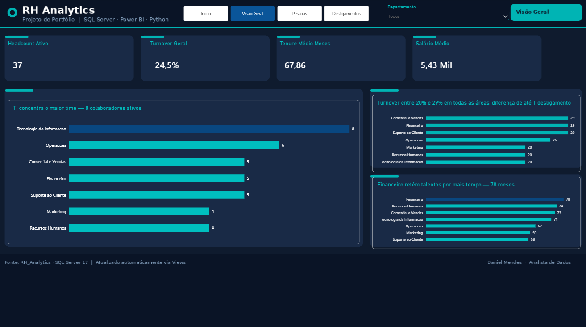
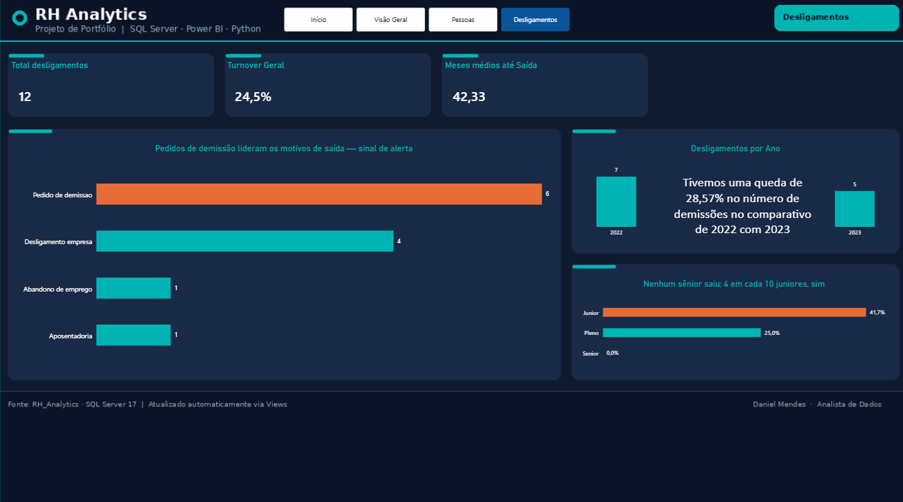
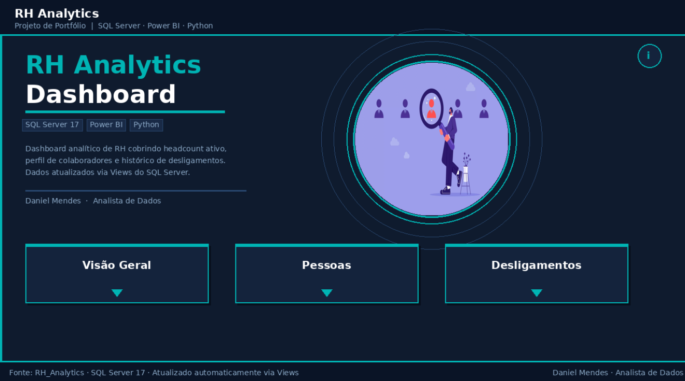
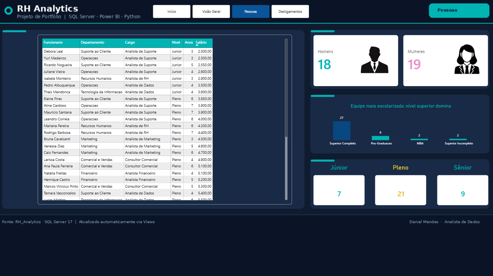

# 👥 RH Analytics — Onde a empresa perde talentos

> Análise de turnover e desligamentos de ponta a ponta: SQL Server → Power BI → Python


---

## 📌 Resumo Executivo

**Pergunta de negócio:** por que a empresa está perdendo pessoas e onde agir primeiro?

**Resposta:** o turnover não é um problema de área, é um problema de carreira.

| # | Achado | Evidência |
|---|--------|-----------|
| 1 | **1 em cada 4 colaboradores deixou a empresa** | 12 desligamentos em 49 colaboradores (24,5%) |
| 2 | **Nenhum sênior saiu; 4 em cada 10 juniores, sim** | Júnior 41,7% · Pleno 25,0% · Sênior 0% |
| 3 | **Juniores são desligados; plenos pedem para sair** | 3 de 5 juniores desligados pela empresa · 5 de 7 plenos pediram demissão, com mediana de 39 meses de casa |

**Recomendação:** rever a contratação e a integração de juniores e criar uma trilha de carreira Pleno → Sênior, com revisão aos 30 meses de casa.

**Impacto estimado:** as 6 saídas voluntárias custaram cerca de **R$ 158 mil** (premissa conservadora de 50% do salário anual por reposição).

### 📽️ Apresentação

| Arquivo | Para quê |
|---------|----------|
| [📄 RH_Analytics_Apresentacao.pdf](apresentacao/RH_Analytics_Apresentacao.pdf) | Leitura rápida: 12 slides de negócio + 5 de apêndice técnico |
| [📊 RH_Analytics_Apresentacao.pptx](apresentacao/RH_Analytics_Apresentacao.pptx) | Versão editável, com notas do apresentador |

---

## 📊 Dashboard Power BI

### Visão Geral
Headcount, turnover geral, tempo médio de casa e salário médio, com recortes por departamento e filtro interativo.



### Desligamentos
Motivos de saída, evolução anual e turnover por nível de senioridade.



<details>
<summary><b>Ver as outras páginas (Início e Pessoas)</b></summary>

### Início


### Pessoas
Tabela de colaboradores com composição por gênero, escolaridade e senioridade.



</details>

---

## 🏗️ Arquitetura

```
SQL Server (4 tabelas + 7 views)  →  Power BI (4 páginas + medidas DAX)  →  Python (6 gráficos)  →  GitHub
```

As views funcionam como camada semântica: o Power BI e o Python leem a mesma regra de negócio, então os números batem entre as ferramentas.

### 🗄️ Modelagem de Dados (SQL Server)

**Tabelas:**
- `Funcionarios`: cadastro com admissão, demissão, motivo de saída, cargo e salário
- `Departamentos`: estrutura organizacional e gestores
- `Cargos`: níveis (Júnior, Pleno, Sênior) e salário base
- `Historico_Movimentacoes`: admissões, promoções, transferências e demissões

**Views (camada de consumo):**

| View | O que entrega | Consumida por |
|------|---------------|---------------|
| `vw_Headcount_Ativo` | Headcount ativo por departamento | Power BI |
| `vw_Turnover_Departamento` | Turnover por área | Power BI · Python |
| `vw_Tenure_Departamento` | Tempo médio de casa por área | Power BI |
| `vw_Painel_Executivo` | KPIs consolidados, uma linha por área | Power BI |
| `vw_Funcionarios_Ativos` | Ficha completa de cada ativo | Power BI · Python |
| `vw_Desligamentos` | Histórico de saídas com motivo e tempo de casa | Power BI · Python |
| `vw_Turnover_Nivel` | Turnover por senioridade | Power BI · Python |

**Destaques de SQL:** CTEs encadeadas, window functions (`RANK`, `DENSE_RANK`, `LAG`, `AVG OVER`) e stored procedure com parâmetro opcional. Script completo em [`sql/RH analytics projeto.sql`](sql/RH%20analytics%20projeto.sql).

---

## 🐍 Análise Python

Script que conecta ao SQL Server via `pyodbc` e gera 6 gráficos em matplotlib, com a mesma identidade visual do dashboard:

| # | Gráfico | Tipo |
|---|---------|------|
| 01 | Desligamentos por Ano | Barras verticais |
| 02 | Funcionários Ativos | Barras verticais |
| 03 | Motivo de Saída | Barras verticais |
| 04 | Tempo de Casa por Departamento | Barras horizontais |
| 05 | Turnover por Departamento | Barras horizontais |
| 06 | Turnover por Nível de Senioridade | Barras verticais |

### Como executar

```bash
# 1. Criar e ativar ambiente virtual
python -m venv venv
venv\Scripts\activate          # Windows

# 2. Instalar dependências
pip install pyodbc pandas matplotlib

# 3. Configurar conexão em Python/analise_rh.py
SERVIDOR = "localhost"         # seu servidor SQL Server
BANCO    = "RH_Analytics"

# 4. Executar a partir da raiz do projeto
python Python/analise_rh.py
# → Gráficos salvos em charts/
```

---

## 📐 Definições das Métricas

| Métrica | Definição |
|---------|-----------|
| Headcount ativo | Colaboradores sem `data_demissao` |
| Turnover (%) | Desligados ÷ total de colaboradores do recorte × 100 (acumulado do período, não anualizado) |
| Tempo de casa (meses) | Meses entre admissão e desligamento; para ativos, até a data da consulta |

> **Por que não a média dos percentuais?** A média das 7 áreas daria 24,4%, com cada área pesando igual. A medida DAX `Turnover %` soma desligados e total antes de dividir (12 ÷ 49 = 24,5%), então cada pessoa pesa igual.

---

## ✅ Qualidade de Dados e Limitações

Antes da análise, a base foi validada e as inconsistências encontradas foram corrigidas: 3 demissões do histórico ligadas ao colaborador errado, cargos de admissão incoerentes com promoções posteriores, um título de gráfico que contradizia os dados e o turnover calculado como média de percentuais.

**Limitações:** amostra pequena (49 pessoas, então diferenças de 1 desligamento mudam bastante os percentuais) · turnover acumulado, não anualizado · dados simulados.

---

## 📁 Estrutura do Repositório

```
projeto-rh-analytics/
├── apresentacao/      # Apresentação em PDF e PowerPoint
├── sql/               # Script SQL: tabelas, carga, análises e views
├── Python/            # Script de análise em Python
├── charts/            # 6 gráficos gerados pelo Python
├── Screenshots/       # Prints das 4 páginas do dashboard
├── Backgrounds/       # Fundos customizados do dashboard
├── RH_Analytics_Dashboard.pbix
└── README.md
```

---

## 🎨 Identidade Visual

| Cor | Hex | Uso |
|-----|-----|-----|
| Fundo Principal | `#0F1B2E` | Fundo das páginas e dos gráficos |
| Fundo Card | `#192A46` | Cards e áreas de gráfico |
| Turquesa | `#00B4B4` | Série de dados principal |
| Laranja | `#E8703A` | Destaque e alerta (o ponto que exige atenção) |
| Cinza | `#8D99AE` | Eixos, rótulos e contexto |

---

## 👤 Autor

**Daniel Mendes** · Analista de Dados | SQL · Power BI · Python

[Portfólio](https://claude.ai/artifact/TMgbaE1TNWBpaj9uPPN8XL) · [LinkedIn](https://www.linkedin.com/in/danielgmendes/) · [GitHub](https://github.com/DanielMendes-Dados)

---

*Projeto desenvolvido para portfólio profissional, com dados simulados (49 colaboradores, 7 departamentos, desligamentos entre 2022 e 2023).*
